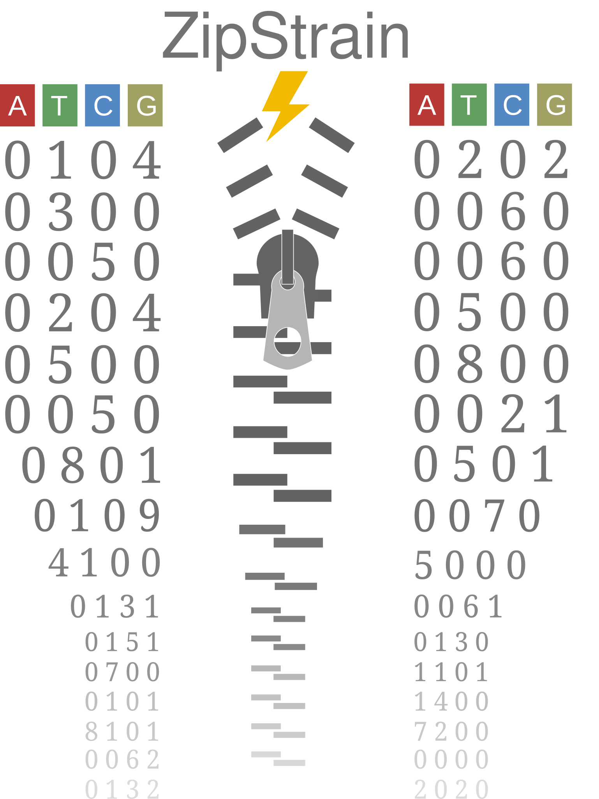

# Welcome to ZipStrain 

ZipStrain is a toolkit for strain-level metagenomic profiling and comparison.
It is the spiritual successor to [InStrain](https://instrain.readthedocs.io/en/latest/) but with literally orders of magnitude increases in speed while using substantially less RAM.

Source code is [available on GitHub](https://github.com/OlmLab/ZipStrain)

Publication is available on [bioRxiv](https://doi.org/10.64898/2026.05.20.726564)

See links to the left for [installation instructions](./installation.md) and [tutorials](./Tutorial.md)

!!! note "ZipStrain 2.0"
    These pages describe ZipStrain 2.0. Version 2 keeps position profiles gene-free and stores genes once in a shared catalog, adds per-gene dN/dS and pN/pS from codons observed within reads, and adds pair analyses for recombination ([recombination mosaics](parameter_selection/recombination/index.md)). Profiles from 1.x and 2.0 cannot be compared with each other; see the [changelog](https://github.com/OlmLab/ZipStrain/blob/main/changelog.md) for migrating from 1.x and the [V2 guide](v2.md) for file formats.

Bugs reports and feature requests can be submitted through [GitHub](https://github.com/OlmLab/ZipStrain)

ZipStrain was developed by [Parsa Ghadermazi](https://www.linkedin.com/in/parsa-ghadermazi/) in the [Olm Lab](https://www.colorado.edu/lab/olm/) at the University of Colorado Boulder.
