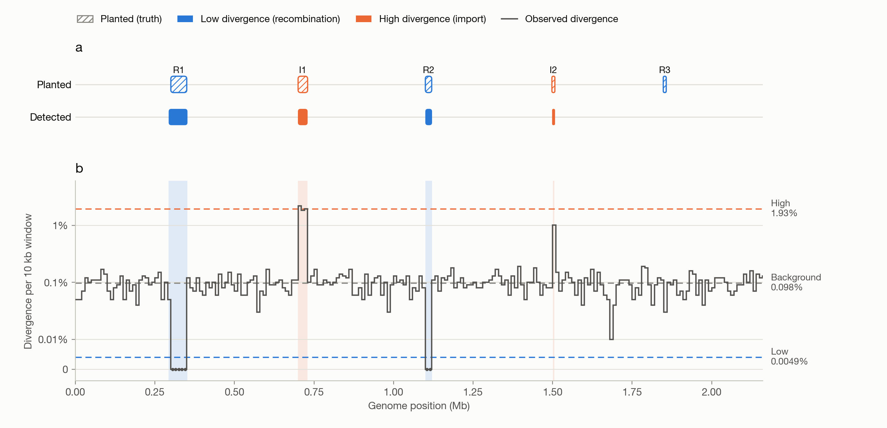
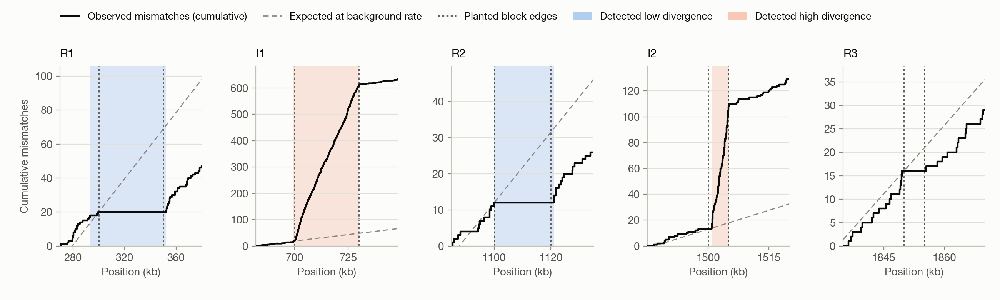
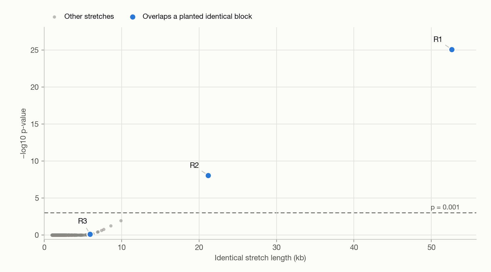
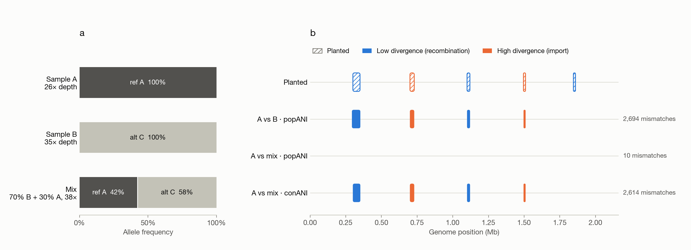

# Finding recombination mosaics

Two samples of the same strain differ by only a few mutations, scattered more or less at
random along the genome. Recombination breaks that pattern. A segment that the two lineages
exchanged recently looks **too similar**: a long run with almost no differences. A segment
imported from a more distant lineage looks **too different**: a dense cluster of differences.

ZipStrain 2.0 has two functions for finding these patterns between two profiled samples:

| Function | What it finds |
|---|---|
| `identical_stretches` | Runs of shared positions where the two samples never differ, with a p-value for how surprising each run's length is |
| `mosaic_regions` | Blocks whose divergence is much **lower** (`low_divergence`) or much **higher** (`high_divergence`) than the genome's background |

Both follow ideas developed by Ben Good and colleagues for detecting recombination between
closely related strains in gut metagenomes ([Garud et al., 2019](#references);
[Liu & Good, 2024](#references)). Comparing pairs of closely related strains, modelling the
genome as clonal background interrupted by recombined segments, and testing whether a run of
shared sequence is longer than randomly scattered mutations would allow are all from that
work. ZipStrain provides simplified versions that work directly on its profiles.

This guide builds a dataset where the answer is known. It takes a real genome, makes a closely
related strain with five planted blocks, simulates reads, runs the normal ZipStrain workflow,
and checks what ZipStrain recovers. The goal is to show how `factor`, `switch_probability`,
`min_length`, and the ANI method affect what is found. The whole run takes about three minutes
on a laptop. In [section 6](#try-it-yourself-what-does-it-cost-to-find-r3) an interactive
explorer reruns `mosaic_regions` on the tutorial's data with your own settings.


<p class="zs-cap">Figure 1. Planted and detected mosaic blocks between samples A and B. (a) The five planted
blocks (hatched; R = recombined, identical to strain A; I = imported, 2% divergent) and the
four blocks <code>mosaic_regions</code> found (solid), coloured by state. R3 was not detected. (b) popANI
divergence in 10 kb windows on a log scale; windows with no mismatch are plotted at 0. Shading
marks the detected blocks. Dashed lines are the model's three states: the refitted background
rate (0.098%), the low state with 20× fewer expected mutations (0.0049%) and the high state
with 20× more (1.93%). On a log axis the three states are equally spaced.</p>

!!! note "Test data"

    | | |
    |---|---|
    | **Reference** | *Streptococcus pneumoniae* TIGR4 (NCBI `NC_003028.3`, 2.16 Mb) |
    | **Strains** | Strain A is the reference; strain B differs at 0.1% of positions, with five planted blocks |
    | **Samples** | 30× paired 150-bp reads from strain A, strain B, and a 70/30 mix of B and A |
    | **ZipStrain** | `2.0.0`, default profiling and comparison settings |

    The scripts that build this dataset and draw every figure are in the ZipStrain repository
    under [`docs/parameter_selection/recombination`](https://github.com/OlmLab/ZipStrain/tree/main/docs/parameter_selection/recombination).
    Strain B and the reads use fixed random seeds, so your numbers should match the tables
    below.

## 1. Set up

```bash
conda create -n recombzs -c conda-forge -c bioconda python=3.12 bowtie2 samtools wgsim matplotlib
conda activate recombzs
python -m pip install "zipstrain==2.0.0"
```

Download the tutorial folder from the repository. It contains:

```text
recombination/
├── run_all.sh                     # runs every step below
├── scripts/
│   ├── 01_make_strains.py         # strain B with planted blocks + truth tables
│   ├── 02_simulate_reads.sh       # 30x paired-end reads with wgsim
│   ├── 03_find_mosaics.py         # mosaic_regions + identical_stretches per pair
│   ├── 04_plot_figures.py         # the figures on this page
│   └── 05_export_explorer_data.py # data for the interactive explorer
├── interactive/                   # mosaic_explorer.html + tutorial_data.js
├── figures/
├── data/                          # created: genomes, reads, truth tables
├── mapped/  profiles/             # created by zipstrain map / profile
└── results/                       # created: one folder of tables per comparison
```

To reproduce everything in one go, run `bash run_all.sh` inside that folder. The sections
below go step by step.

## 2. Build two strains with known mosaics

The reference is *Streptococcus pneumoniae* TIGR4. The pneumococcus is one of the most
recombinogenic bacteria known, and its genome is small enough to keep the tutorial fast.

```bash
mkdir -p data/reference
curl -sSfL -o data/reference/TIGR4.fna \
  "https://eutils.ncbi.nlm.nih.gov/entrez/eutils/efetch.fcgi?db=nuccore&id=NC_003028.3&rettype=fasta&retmode=text"

python scripts/01_make_strains.py --reference data/reference/TIGR4.fna --outdir data
```

**Strain A** is the reference itself. **Strain B** is a copy that differs from A at random
positions at a rate of 0.1%, so the two strains are about 99.9% identical. That is the range
`mosaic_regions` is designed for: roughly 99% to 99.99% popANI. Inside five blocks the
background rate is replaced:

| Block | Kind | Position | Length | Inside the block | Differences planted |
|---|---|---|---:|---|---:|
| R1 | recombination | 300,001–350,000 | 50 kb | identical to A | 0 |
| I1 | import | 700,001–730,000 | 30 kb | 2% divergent | 596 |
| R2 | recombination | 1,100,001–1,120,000 | 20 kb | identical to A | 0 |
| I2 | import | 1,500,001–1,505,000 | 5 kb | 2% divergent | 115 |
| R3 | recombination | 1,850,001–1,855,000 | 5 kb | identical to A | 0 |

The script writes `strain_A.fna`, `strain_B.fna`, an STB file that assigns the chromosome to
genome `TIGR4`, and the truth tables `data/truth/planted_blocks.tsv` and
`data/truth/snps.tsv`. The block sizes are chosen to span the detection limit, so not every
block is expected to be found.

## 3. Simulate reads

```bash
bash scripts/02_simulate_reads.sh data
```

This simulates 30× coverage of 2×150 bp reads for three samples with
[wgsim](https://github.com/lh3/wgsim), using a 0.1% sequencing error rate:

| Sample | Reads from |
|---|---|
| `sample_A` | strain A |
| `sample_B` | strain B |
| `sample_M` | a mixed population: 70% strain B, 30% strain A (used in [section 8](#8-mixed-populations-popani-vs-conani)) |

wgsim's own mutation and indel options are set to zero, so every difference between the
samples is one we planted. The script also writes `data/reads.csv` for `zipstrain map`.

## 4. Map and profile

These are the standard ZipStrain commands. All three samples are mapped to strain A.

```bash
zipstrain map -i data/reads.csv -o mapped \
  -f data/strain_A.fna -s data/reference.stb -t 4

zipstrain profile -i mapped/samples.txt -f data/strain_A.fna \
  -s data/reference.stb -r profiles --threads 4
```

Each sample now has a position profile, for example
`profiles/sample_B/sample_B_profile.parquet`, holding the A/C/G/T counts at every position.
Sample B's genome stats report 29.9× coverage and 99.9997% breadth.

## 5. Find mosaic regions

Everything from here on is Python. `PairComparison` validates two profiles once and joins
them on shared positions. Its analyses are lazy, and collecting them together with
`pair.collect` runs that join once:

```python
import polars as pl
from zipstrain.compare import PairComparison

pair = PairComparison(
    "profiles/sample_A/sample_A_profile.parquet",
    "profiles/sample_B/sample_B_profile.parquet",
)
blocks, stretches = pair.collect(
    pair.mosaic_regions(),
    pair.identical_stretches(min_length=1_000),
)
print(blocks.sort("start"))
```

Sort after collecting, as above, not before. `scripts/03_find_mosaics.py` runs this for each
comparison, adds per-window mismatch counts for plotting, and writes everything to
`results/`. For samples A and B, `mosaic_regions` returns four blocks:

| state | start | end | callable_positions | mismatches | divergence | background_divergence | log_likelihood_ratio |
|---|---:|---:|---:|---:|---:|---:|---:|
| low_divergence | 293,181 | 352,311 | 59,131 | 3 | 0.0051% | 0.098% | 45.9 |
| high_divergence | 699,399 | 729,995 | 30,567 | 597 | 1.95% | 0.098% | 1226.7 |
| low_divergence | 1,099,888 | 1,121,075 | 21,188 | 1 | 0.0047% | 0.098% | 16.7 |
| high_divergence | 1,500,875 | 1,505,224 | 4,334 | 96 | 2.2% | 0.098% | 208.0 |

How to read the columns:

- **`state`** is `low_divergence` (too few mismatches: a candidate recent recombination) or
  `high_divergence` (too many: a candidate import).
- **`callable_positions`** counts positions covered (at least 5×) in *both* samples. Positions
  that are not shared are skipped, not counted as matches.
- **`background_divergence`** is the genome's mismatch rate after the blocks are excluded. It
  starts at the genome-wide popANI rate (0.125% here) and is refitted, so the 600 extra
  mismatches in the import do not inflate it.
- **`log_likelihood_ratio`** is how much better the block fits its state than the background,
  in natural-log units. Larger is stronger.

### How the model works

Mismatches are the only events that matter, so the model steps from one mismatch to the
next. Each step is a run of `g` matching positions closed by a mismatch. In a state with
mismatch rate `r`, that has likelihood `(1 − r)^g · r`. There are three states: the
background rate `d`, a rate with 20× fewer expected mutations, and one with 20× more
(`factor=20`). Viterbi decoding picks the most likely state for every run. The state can
change only at a mismatch, with probability `switch_probability` (default `1e-3`). Because
the model runs over mismatches rather than positions, a whole genome takes as many steps as
it has mismatches: about 2,700 here.

On the log axis of Figure 1b, the three states are equally spaced dashed lines. The windowed
divergence sits on the background line except where blocks were planted.

This is a simplified form of the close-pair hidden Markov model (CP-HMM) of
[Liu & Good (2024)](#references), which moves along the genome between clonal and recombined
regions. Their model learns how many differences a recombined fragment brings in from the
observed distribution of local divergence, and its transition rates vary from pair to pair.
ZipStrain instead uses fixed rates, a factor above and below the background, so it needs no
training data and also reports unusually *similar* blocks.

## 6. What was found, and what was missed

`results/evaluation.tsv` matches each planted block with the detected block of the same kind
that overlaps it most:

| Block | Planted | Detected | Start offset | End offset | log LR |
|---|---|---|---:|---:|---:|
| R1 · 50 kb identical | 300,001–350,000 | 293,181–352,311 | −6,820 | +2,311 | 45.9 |
| I1 · 30 kb at 2% | 700,001–730,000 | 699,399–729,995 | −602 | −5 | 1226.7 |
| R2 · 20 kb identical | 1,100,001–1,120,000 | 1,099,888–1,121,075 | −113 | +1,075 | 16.7 |
| I2 · 5 kb at 2% | 1,500,001–1,505,000 | 1,500,875–1,505,224 | +874 | +224 | 208.0 |
| R3 · 5 kb identical | 1,850,001–1,855,000 | not detected | | | |

There were no false positives: every detected block overlaps a planted one. Figure 2 zooms in
on each block. The black line counts mismatches from left to right, so its slope is the local
divergence. Inside an identical block the line goes flat. Inside an import it climbs steeply.


<p class="zs-cap">Figure 2. Cumulative mismatches between samples A and B around each planted block: R1
(50 kb, identical), I1 (30 kb, 2% divergent), R2 (20 kb, identical), I2 (5 kb, 2% divergent)
and R3 (5 kb, identical). The slope of the black line is the local divergence: it goes flat
inside an identical block and climbs steeply inside an import. The dashed grey line is the
slope expected at the background rate, anchored where each planted block starts. Dotted lines
mark the planted edges, and shading marks what <code>mosaic_regions</code> detected. R3 has no shading:
at the background rate it should hold only about 5 mismatches, too few to stand out.</p>

### Boundaries snap to mismatches

A recombination edge between two identical sequences leaves no trace, so a block can only
start or end at a mismatch. In R1, the stretch from about 293 to 300 kb happened to carry only
2 mismatches in 7 kb, against about 7 expected. The model reasonably absorbed it into the
block, which is why the detected start is 6.8 kb early. The expected error at an edge is
roughly the typical distance between mismatches in the neighbouring state: about 1 kb at a
0.1% background.

### The detection limit

Finding a block costs something: entering and leaving a state costs about
`2 × ln(2 / switch_probability) ≈ 15` log-likelihood units. A low-divergence block repays
that only if it **should** have contained enough mismatches at the background rate:

| Block | Length | Mismatches expected at 0.098% | Detected? |
|---|---:|---:|---|
| R1 | 50 kb | 49 | yes (log LR 45.9) |
| R2 | 20 kb | 20 | yes, only just (log LR 16.7) |
| R3 | 5 kb | 5 | no |

!!! tip "Rule of thumb"

    **A recombined (identical) block is detectable once it is long enough to have expected
    15–20 background mismatches**, that is about `15 / d` positions. This matches the criterion
    [Liu & Good (2024)](#references) use for a "long" shared segment: length × divergence above
    15. At 99.9% ANI that is about 15–20 kb. Between strains at 99.99% ANI it is about
    150–200 kb. Imports are much easier to find, because every extra mismatch adds evidence
    (about `ln 20 ≈ 3` units each), so the 5 kb import I2 was detected easily.

You can trade sensitivity against false positives with `switch_probability`. A larger value
makes switching cheaper and finds shorter blocks, but also finds more spurious ones.
`factor` sets how different the two extra states are from the background. The next section
lets you try this on the tutorial's data.

### Try it yourself: what does it cost to find R3?

The explorer below loads the A-vs-B mismatches from this run (`interactive/tutorial_data.js`,
written by `scripts/05_export_explorer_data.py`) and runs the same decoder as `mosaic_regions`
live as you move the `factor` and `switch_probability` sliders. At the default settings it
reproduces the table above exactly: four of five blocks, no false positives. Its JavaScript port
gives the same blocks, boundaries and log-likelihood ratios as ZipStrain 2.0.0.

R3 can be found, but only at a price. Its identical run is 5,929 shared positions, where about
6 background mismatches would be expected, far below the ~15 needed at the defaults. Click
**show** in a row to load its settings into the explorer:

| factor | switch_probability | Planted blocks found | False positives | |
|---:|---:|---|---:|---|
| 20 | 0.001 (default) | R1, I1, R2, I2 | 0 | [show](interactive/mosaic_explorer.html#data=tutorial&factor=20&switch=0.001) |
| 20 | 0.1 | R1, I1, R2, I2 | 6 | [show](interactive/mosaic_explorer.html#data=tutorial&factor=20&switch=0.1) |
| 20 | 0.3 | all five | 38 | [show](interactive/mosaic_explorer.html#data=tutorial&factor=20&switch=0.3) |
| 7 | 0.13 (*Catch R3* button) | all five | 9 | [show](interactive/mosaic_explorer.html#data=tutorial&factor=7&switch=0.13) |

Even the cheapest setting does not find R3 on its own merit. A chance cluster of four mismatches
just before R3 is called a (false) high-divergence block, and moving straight from that block into
the low state costs one switch instead of two. So the low block over R3 is real, but it is found
through a spurious neighbour, and eight other false blocks come with it. With data like these, a
5 kb recombined block is below what the method can reliably see. In the explorer, R3's dot on the
evidence chart stays below the cost line even when it is found, and its close-up shows the false
block next to it.

<div class="zs-plotwrap"><iframe class="zs-plot" id="mosaic-explorer" title="Mosaic explorer: mosaic_regions on the tutorial data" src="interactive/mosaic_explorer.html?embed=1" style="width:100%;height:2600px"></iframe></div>
<p class="zs-cap">Interactive explorer: <code>mosaic_regions</code> rerun on the A-vs-B mismatches with the slider settings. <a href="interactive/mosaic_explorer.html" target="_blank" rel="noopener">Open it in its own tab</a>.</p>

Other things to try:

- Switch to *Simulated strains* to draw new mismatches over the same genome and the same five
  blocks. Lower the background ANI towards
  [99.99%](interactive/mosaic_explorer.html#data=simulated&ani=99.99&factor=20&switch=0.001) and the shortest detectable
  identical run grows to about 200 kb; raise it to
  [99.5%](interactive/mosaic_explorer.html#data=simulated&ani=99.5&factor=20&switch=0.001) and R3 is found at the default
  settings.
- Push `switch_probability` towards [0.6](interactive/mosaic_explorer.html#data=tutorial&factor=20&switch=0.6) and the genome
  breaks into hundreds of blocks.
- With a [99.99% background and 8% imports](interactive/mosaic_explorer.html#data=simulated&ani=99.99&imports=8&factor=20&switch=0.001),
  the imports hold most of the mismatches. The starting background rate is then far too high,
  most of the genome fits the low state, and the background is never refitted. The explorer
  flags this; real data with one dominant import can behave the same way.

## 7. Identical stretches and their p-values

`identical_stretches` lists every unbroken run of matching shared positions. A stretch ends at
a mismatch, at a position that is not covered in both samples, or at the end of a scaffold.
Each stretch gets a p-value: the chance that a genome with this many mismatches, scattered at
random, would contain a run at least this long anywhere. The test follows
[Liu & Good (2024)](#references), who used the longest run of shared ancestry between two
strains as a test statistic and compared it with runs expected if mutations were randomly
scattered across the genome.


<p class="zs-cap">Figure 3. Length and significance of every identical stretch of at least 1 kb between
samples A and B (728 stretches). Blue points are the stretches overlapping the planted
identical blocks R1 (52.6 kb, p = 8 × 10⁻²⁶), R2 (21.2 kb, p = 9 × 10⁻⁹) and R3 (5.9 kb,
p = 0.8). Grey points are runs that arise by chance between background mismatches; the
longest of them is 9.9 kb (p = 0.012). The dashed line marks p = 0.001.</p>

The stretches covering R1 (52.6 kb, p = 8 × 10⁻²⁶) and R2 (21.2 kb, p = 9 × 10⁻⁹) stand far
apart from the rest. R3's stretch (5.9 kb, p = 0.8) cannot be told apart from chance, which is
the same limit `mosaic_regions` hit.

The longest unplanted run is 9.9 kb with p = 0.012. These p-values already account for
searching the whole genome, but at p < 0.05 you should still expect about one false call in
twenty genomes. When you scan many genomes or many sample pairs, use a much stricter cutoff
(the figure shows p = 0.001), or rely on `mosaic_regions`, which did not call this region.

!!! tip "Which function to use?"

    `identical_stretches` is simple and exact, but one sequencing error or one shared mutation
    splits a stretch in two. `mosaic_regions` tolerates a few mismatches inside a block (R1
    holds 3) and also finds imports, which identical stretches cannot see. Use stretches for a
    quick look and `mosaic_regions` for calls.

## 8. Mixed populations: popANI vs conANI

Metagenomes often contain more than one strain of a species. Sample M is 70% strain B and
30% strain A. Compared with sample A, it should show the same mosaics as sample B, but
popANI finds almost nothing:


<p class="zs-cap">Figure 4. A strain mixture hides mosaics from popANI but not from conANI. (a) Base
frequencies at position 700,002 inside import I1, where strain B carries C instead of the
reference A, with each sample's depth. Sample A and the mix share base A, so popANI counts a
match; their majority bases differ (A vs C), so conANI counts a mismatch. The mix was
simulated at 70% B, and the 58% seen here is sampling noise at 38×. (b) The planted blocks
(hatched) and the blocks <code>mosaic_regions</code> found when sample A is compared with sample B and
with the mix under each ANI definition, with the genome-wide mismatch count on the right.
popANI on the mix finds no blocks.</p>

popANI counts a mismatch only when the two samples share **no** allele. At every planted site
the mix still carries strain A's base, so it shares an allele with sample A. Instead of
2,694 mismatches, only 10 remain genome-wide, and `mosaic_regions` has nothing to work with.
conANI compares the **majority** base in each sample instead. The mix's majority is strain B's
base, so 2,614 mismatches come back and all four detectable blocks are recovered.

Choose the definition with `ani_method`:

```python
pair = PairComparison(profile_a, profile_mix, ani_method="conani")
```

- Use **popANI** (the default) when each sample is dominated by one strain. It is robust to
  low-frequency noise.
- Use **conANI** when a sample may be a mixture. It describes the majority strain, so it
  becomes unreliable when two strains are close to 50/50. In the panel above, the 70/30 mix
  reads 58/42 at one 38× site just by sampling noise.
- Compare popANI and conANI genome ANI for a pair (for example from `zipstrain compare`). A
  large gap between them is a sign of a strain mixture.

## 9. Using this on your own data

1. **Profile your samples** against a shared reference as usual, then compare them with
   `zipstrain compare` to get `genome_ani` for every pair and genome.
2. **Pick pairs in the useful range**: popANI between about 99% and 99.99% for the genome of
   interest. Below 99% almost everything is divergent. Above 99.99% there are too few
   mismatches to estimate a background, and only very long blocks are detectable (see
   [the detection limit](#the-detection-limit)).
3. **Make sure both samples have depth**: at least about 10× over the genome. Only positions
   covered at least 5× in both samples count (`min_cov`).
4. **Run the pair analyses** for each candidate pair, keeping only the genome you care about:

    ```python
    import polars as pl
    from zipstrain.compare import PairComparison

    pair = PairComparison(profile_1, profile_2, ani_method="popani")
    blocks, stretches = pair.collect(pair.mosaic_regions(), pair.identical_stretches(min_length=5_000))
    blocks = blocks.filter(pl.col("genome") == "my_genome").sort("chrom", "start")
    ```

5. **Check `high_divergence` blocks carefully** before calling them imports. Reads recruited
   from another species, multi-copy genes (rRNA operons, transposases, mobile elements) and
   poorly mapped scaffold ends also concentrate mismatches. Look at depth over the block in
   both samples: an import has normal depth, while recruited or multi-copy regions usually
   have raised depth.
6. **Look for hotspots across pairs.** Blocks from a single pair are candidate events.
   Regions where blocks from many independent pairs overlap are candidate recombination
   hotspots. Collect the blocks from every pair into one table, then count how many pairs
   cover each window of the genome. [Liu & Good (2024)](#references) built such sharing
   landscapes across the core genome, scoring each position by the probability that it lies
   in a long shared segment, and compared them with neutral simulations to find regions
   shared more often than expected.

## Recommendation

!!! tip "Defaults for recombination scans"

    Keep the defaults, **`factor=20`** and **`switch_probability=1e-3`**, for calls. On this
    data they found every block above the detection limit with no false positives. Raising
    `switch_probability` finds shorter blocks only at the cost of many false ones.

    Use **popANI** when each sample is dominated by one strain and **conANI** when a sample may
    be a mixture. For `identical_stretches`, use a p-value cutoff much stricter than 0.05 when
    scanning many genomes or pairs.

    Expect to detect a recombined block only when it spans roughly `15 / d` positions at
    background divergence `d`. Treat `high_divergence` blocks as candidates until depth and
    mapping have been checked.

!!! note "Reproducing this guide"

    `bash run_all.sh` regenerates every file from an empty folder. Strain B and the reads use
    fixed random seeds (`--seed 7` in `01_make_strains.py`, `-S` in `02_simulate_reads.sh`).
    Change the seeds, the background rate (`--background-rate`) or `PLANTED_BLOCKS` in
    `scripts/01_make_strains.py` to explore other scenarios, for example longer or shorter
    blocks, or a different divergence for the imports.

## References

- Liu Z, Good BH. (2024). **Dynamics of bacterial recombination in the human gut microbiome.** *PLoS Biology*, 22(2), e3002472. [doi:10.1371/journal.pbio.3002472](https://doi.org/10.1371/journal.pbio.3002472). The source of the close-pair HMM, the longest-run test for shared ancestry, and the genome-wide sharing landscapes that the ZipStrain functions here follow.
- Garud NR, Good BH, Hallatschek O, Pollard KS. (2019). **Evolutionary dynamics of bacteria in the gut microbiome within and across hosts.** *PLoS Biology*, 17(1), e3000102. [doi:10.1371/journal.pbio.3000102](https://doi.org/10.1371/journal.pbio.3000102). Within- and across-host comparison of gut bacterial strains from metagenomes, including evidence for widespread recombination within species.
